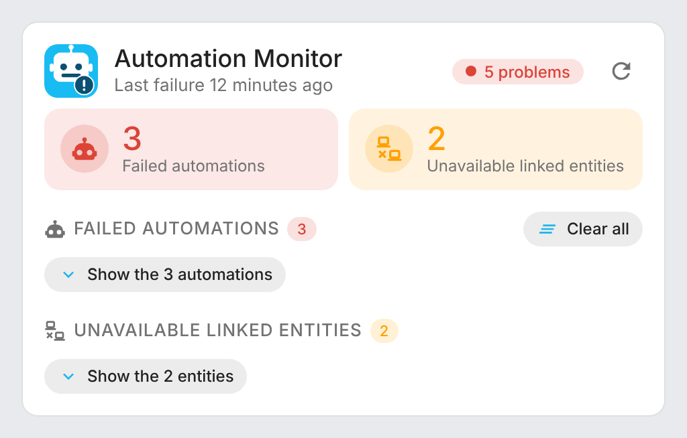
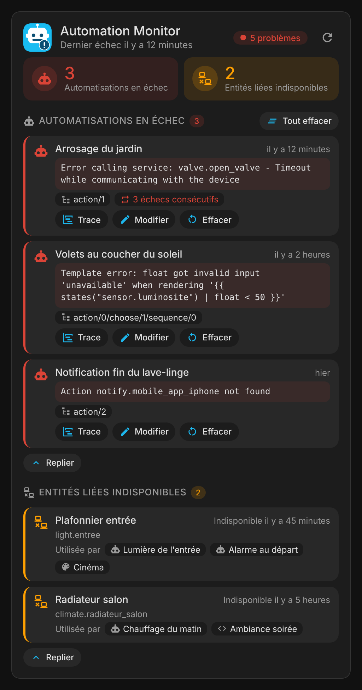
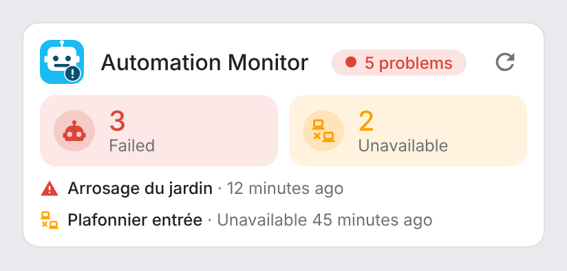
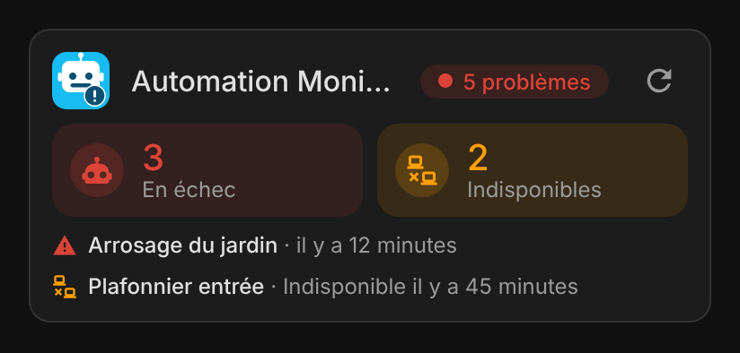
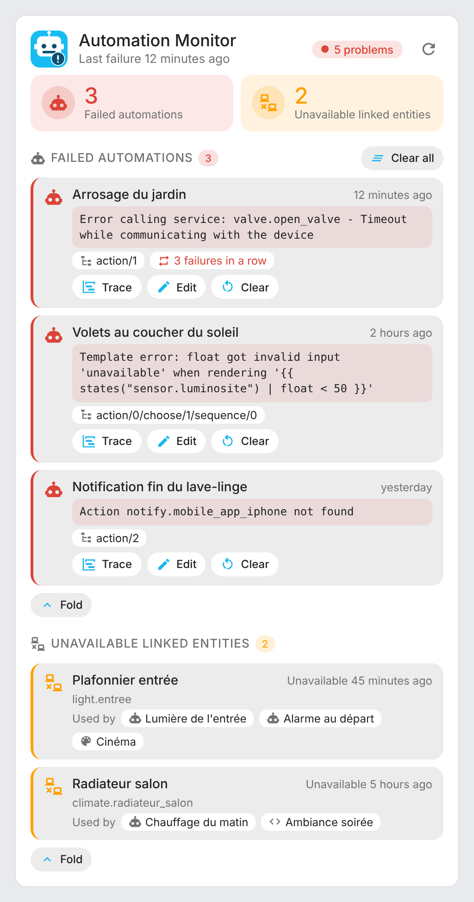
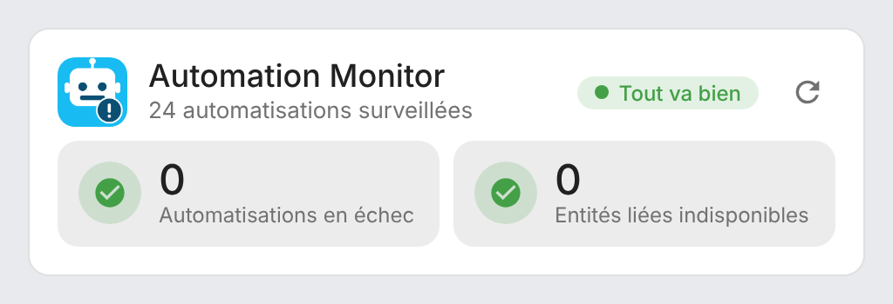
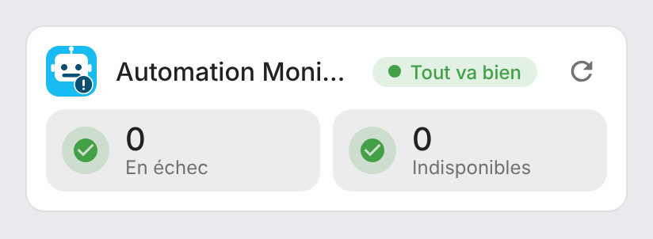

# ha-automation-monitor-card

[](https://github.com/hacs/integration)
[](https://github.com/juju35/ha-automation-monitor-card/actions/workflows/hacs.yml)
[](https://github.com/juju35/ha-automation-monitor-card/actions/workflows/validate.yml)
[](https://github.com/juju35/ha-automation-monitor-card/releases/latest)
[](LICENSE)

<p align="center"></p>

Lovelace cards for Home Assistant showing what the [Automation Monitor](https://github.com/olli-dot-dev/ha-automation-monitor) integration detects: automations whose last run failed, and entities used by your automations, scripts and scenes that are stuck unavailable, with the error details and one-click access to the trace and the editor.

The cards are built on top of the Automation Monitor integration: its two sensors are **discovered automatically** from the Home Assistant entity registry, you don't have to pick them, and it works whatever your Home Assistant language.

[](https://my.home-assistant.io/redirect/hacs_repository/?owner=juju35&repository=ha-automation-monitor-card&category=plugin)

| Automation Monitor Card | Automation Monitor Mini Card |
|---|---|
|  |  |

## Features

- Two cards: a full **Automation Monitor Card** and a compact **Automation Monitor Mini Card**
- Overall status at a glance: all good, or the number of problems
- Counters of failed automations and unavailable linked entities; a list is only shown when it has something to show
- Failed automations: name, time of the last failure, error message, failed step and consecutive failures
- **Trace** and **Edit** buttons opening the automation's trace and editor in Home Assistant
- **Clear** a failure (or **Clear all**) with the integration's `automation_monitor.reset` action, with confirmation
- Unavailable linked entities: name, entity id, how long it has been unavailable and the automations, scripts and scenes that use it (click one to open its editor)
- **Refresh** button in the header of both cards, always visible, rebuilding the list of linked entities (`automation_monitor.rebuild_linked_entities`)
- Lists with several items are folded by default and unfold in one click; long lists are cut to a configurable number of items, with a "Show more" button
- Click a counter, an automation or an entity to open its Home Assistant more-info dialog
- Click the Automation Monitor logo to open the [integration's page](https://github.com/olli-dot-dev/ha-automation-monitor)
- Visual editor in the dashboard UI for both cards (no YAML needed)
- Light and dark mode, English and French
- Single file, no external dependency, the logo is embedded

## Prerequisites

The [Automation Monitor integration](https://github.com/olli-dot-dev/ha-automation-monitor) must be installed and configured (it is available in HACS as a custom repository), with Home Assistant 2024.1 or later.

## Installation

### Via HACS (recommended)

Click the button below to add the repository directly:

[](https://my.home-assistant.io/redirect/hacs_repository/?owner=juju35&repository=ha-automation-monitor-card&category=plugin)

Then click **Download**, and reload your browser when HACS asks you to.

Or manually:

1. Open HACS → **⋮** (top right) → **Custom repositories**
2. Add `https://github.com/juju35/ha-automation-monitor-card` — Type: **Dashboard**
3. Search for **Automation Monitor Card** and click **Download**
4. Clear your browser cache and refresh

### Manual

1. Download `automation-monitor-card.js` from the [latest release](https://github.com/juju35/ha-automation-monitor-card/releases/latest) (or `dist/automation-monitor-card.js` from this repository)
2. Copy it to `/config/www/automation-monitor-card.js`
3. Go to **Settings → Dashboards → ⋮ → Resources** → Add resource:
   - URL: `/local/automation-monitor-card.js`
   - Type: **JavaScript Module**
4. Clear your browser cache and refresh

## Configuration

### Visual editor

Edit a dashboard, click **Add card** and search for **Automation Monitor Card** or **Automation Monitor Mini Card**. There is nothing to pick: the sensors of the integration are found automatically. Set an optional title, choose the sections to display, whether lists are folded, the action buttons, the number of items per list and the language. The preview updates live, and options left at their default are kept out of the generated YAML.

### Minimal

```yaml
type: custom:automation-monitor-card
```

```yaml
type: custom:automation-monitor-mini-card
```

### Full options

```yaml
type: custom:automation-monitor-card
title: Automations
show_logo: true
show_failed: true
show_linked: true
collapse_failed: true
collapse_linked: true
show_details: true
show_controls: true
max_items: 5
language: fr
```

```yaml
type: custom:automation-monitor-mini-card
title: Automations
show_logo: true
show_failed: true
show_linked: true
language: fr
```

### Options reference

| Option | Card | Default | Description |
|---|---|---|---|
| `title` | both | `Automation Monitor` | Card title |
| `show_logo` | both | `true` | Show the Automation Monitor logo (opens the [integration's page](https://github.com/olli-dot-dev/ha-automation-monitor) in a new tab) |
| `show_failed` | both | `true` | Failed automations (counter and list) |
| `show_linked` | both | `true` | Unavailable linked entities (counter and list) |
| `collapse_failed` | full | `true` | Fold the failed automations when there are several (one click unfolds them); `false` always shows them |
| `collapse_linked` | full | `true` | Fold the unavailable linked entities when there are several (one click unfolds them); `false` always shows them |
| `show_details` | full | `true` | Error message of each failed automation |
| `show_controls` | full | `true` | Clear and Clear all buttons (the Trace and Edit links and the Refresh button are always shown) |
| `max_items` | full | `5` | Items shown per list before the "Show more" button |
| `failed_entity` | both | Auto | Failed automations sensor, only needed if it can't be found automatically |
| `linked_entity` | both | Auto | Unavailable linked entities sensor, only needed if it can't be found automatically |
| `language` | both | Auto | Force language: `fr` or `en` (auto-detects from HA settings) |

## Screenshots

| Light (lists folded by default) | Dark (French, lists unfolded) |
|---|---|
|  |  |
|  |  |

Lists unfolded:



When everything works:

| Automation Monitor Card | Automation Monitor Mini Card |
|---|---|
|  |  |

## How it works

The integration exposes two sensors: **Failed automations**, whose `automations` attribute lists the automations whose last run failed (error message, failed step, time, consecutive failures), and **Linked entities unavailable**, whose `entities` attribute lists the entities used by automations, scripts and scenes that have been unavailable longer than the configured threshold. The cards find both sensors in the entity registry by their `translation_key` (`failed_automations`, `linked_entities_unavailable`), so they work even when the entity ids are translated or renamed.

The **Trace** and **Edit** buttons use the automation's id: they work for automations created in the UI (or with an `id:` in YAML). Scripts and scenes listed under **Used by** open their editor the same way.

**Clear** calls `automation_monitor.reset` for one automation, **Clear all** for all of them: the failure disappears until the automation fails again. **Refresh** calls `automation_monitor.rebuild_linked_entities`, useful right after editing a script or a scene.

What counts as a failure, the unavailability threshold, the exclusions and the Repairs issues are set in the integration's options: see its [documentation](https://github.com/olli-dot-dev/ha-automation-monitor#configuration).

## Development

```bash
npm install
npm run build        # bundles src/automation-monitor-card.js + images/ into dist/automation-monitor-card.js
npm run check        # verifies dist/ is up to date (run in CI)
npm run screenshots  # renders the cards with mock data (scripts/mock-states.mjs) into screenshots/
```

### Releasing

1. Add a `## <version>` section at the top of [CHANGELOG.md](CHANGELOG.md)
2. Run the **Release** workflow from the Actions tab with that version

The workflow builds the card, creates the tag and the GitHub release with the changelog section as notes, and attaches `automation-monitor-card.js`.

## Translations

The cards auto-detect the language from your Home Assistant settings. Currently supported:

| Language | Code |
|---|---|
| English | `en` |
| Français | `fr` |

Contributions for additional languages are welcome!

## Credits

The Automation Monitor integration and its logo are by [olli-dot-dev](https://github.com/olli-dot-dev/ha-automation-monitor) (MIT License). This project is an independent card for it.

## License

[MIT](LICENSE)
