# ha-automation-monitor-card

<p align="center"></p>

> [!WARNING]
> **Deprecated, this repository is archived.** The Automation Monitor cards are now served by [System Hub](https://github.com/juju35/ha-system-hub), under the same names (`custom:automation-monitor-card`, `custom:automation-monitor-mini-card`). No more updates are published here: install System Hub, then remove this card's dashboard resource so it is not registered twice. See [Migrating](https://github.com/juju35/ha-system-hub#migrating).

[](https://www.home-assistant.io/integrations/marketplace/)
[](https://github.com/juju35/ha-automation-monitor-card/actions/workflows/hacs.yml)
[](https://github.com/juju35/ha-automation-monitor-card/actions/workflows/validate.yml)
[](https://github.com/juju35/ha-automation-monitor-card/actions/workflows/lint.yml)
[](https://github.com/juju35/ha-automation-monitor-card/releases/latest)
[](https://github.com/juju35/ha-automation-monitor-card/blob/main/LICENSE)
[](https://buymeacoffee.com/julienstep9)

<p align="center"></p>

Lovelace cards for Home Assistant showing what the [Automation Monitor](https://github.com/olli-dot-dev/ha-automation-monitor) integration detects: automations whose last run failed, and entities used by your automations, scripts and scenes that are stuck unavailable, with the error details and one-click access to the trace and the editor.

The cards are built on top of the Automation Monitor integration: its two sensors are **discovered automatically** from the Home Assistant entity registry, you don't have to pick them, and it works whatever your Home Assistant language.

[](https://my.home-assistant.io/redirect/marketplace_repository/?owner=juju35&repository=ha-automation-monitor-card&category=plugin)

| Automation Monitor Card | Automation Monitor Mini Card |
|---|---|
| 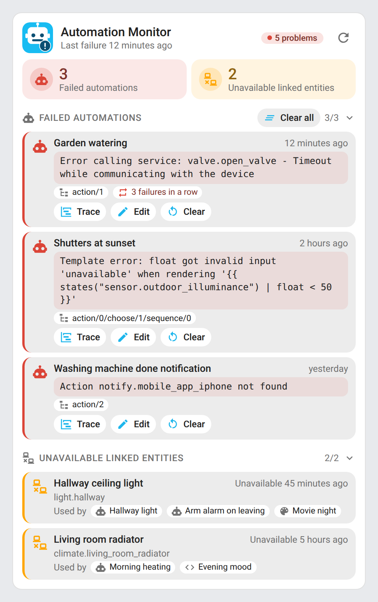 | 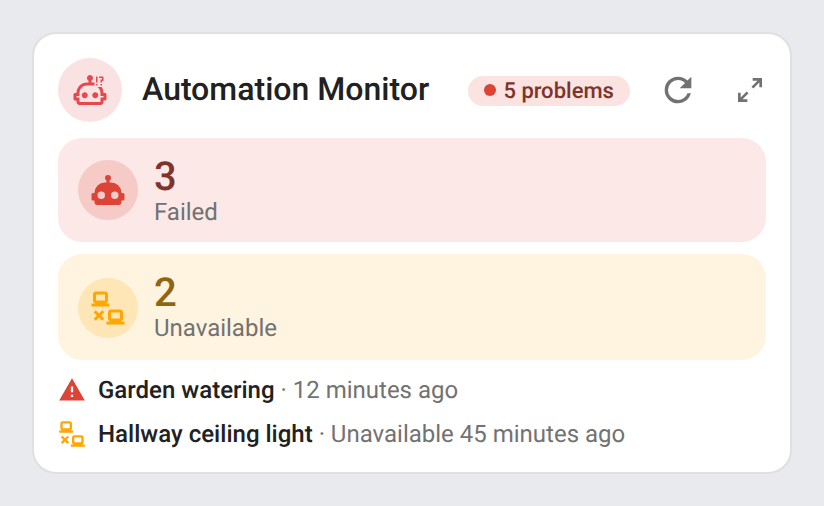 |

## Features

- Two cards: a full **Automation Monitor Card** and a compact **Automation Monitor Mini Card**
- Overall status at a glance: all good, the number of problems, or "Sensor unavailable" when a sensor of the integration cannot be read (its counter then shows a dash instead of 0)
- Counters of failed automations and unavailable linked entities; a list is only shown when it has something to show
- Failed automations: name, time of the last failure, error message, failed step and consecutive failures
- **Trace** and **Edit** buttons opening the automation's trace and editor in Home Assistant
- **Clear** a failure (or **Clear all**) with the integration's `automation_monitor.reset` action, with confirmation
- Unavailable linked entities: name, entity id, how long it has been unavailable and the automations, scripts and scenes that use it (click one to open its editor)
- **Refresh** button in the header of both cards, rebuilding the list of linked entities (`automation_monitor.rebuild_linked_entities`)
- Detail button at the top right of the mini card: it switches to the full card and back; a click anywhere outside the card brings the compact view back
- Failed automations and unavailable linked entities are folded by default: click the section title to unfold them; long lists are cut to a configurable number of items, with a "Show more" button
- Click a counter, an automation or an entity to open its Home Assistant more-info dialog
- Trace, Edit, Clear, Clear all, Refresh and the editor links under **Used by** are for administrators only: other users don't see them (a **Used by** item opens its more-info dialog instead)
- Visual editor in the dashboard UI for both cards (no YAML needed)
- Narrow cards (6 columns of the Sections view, the mini card's default size, down to ~156 px on a phone) stay readable: below ~384 px **Clear all** shows only its icon and the counters stack; the icon gets smaller below 320 px and is hidden below 280 px, so the status chip keeps its whole label; below 245 px the chip shrinks to its dot (its text stays in the tooltip)
- Light and dark mode, English, French, German, Spanish, Serbian (Cyrillic and Latin), Italian, Dutch, European Portuguese, Polish, Romanian, Danish, Swedish, Bulgarian, Russian, Ukrainian, Hungarian, Slovak, Czech, Slovenian, Latvian and Greek
- Single file, no external dependency

## Supported integrations

| Integration | What the cards show |
|---|---|
| [Automation Monitor](https://github.com/olli-dot-dev/ha-automation-monitor) (Marketplace, added from a link) | Overall status, failed automations (last failure, error, failed step, consecutive failures) with **Clear** (`automation_monitor.reset`), unavailable linked entities and the automations, scripts and scenes using them, **Refresh** (`automation_monitor.rebuild_linked_entities`) |

## Prerequisites

The [Automation Monitor integration](https://github.com/olli-dot-dev/ha-automation-monitor) must be installed and configured (it is available in the Marketplace, added from a link), with Home Assistant 2024.8 or later.

## Installation

### Via the Marketplace (recommended)

Click the button below to add the repository directly:

[](https://my.home-assistant.io/redirect/marketplace_repository/?owner=juju35&repository=ha-automation-monitor-card&category=plugin)

Then click **Install**, and reload your browser when the Marketplace asks you to.

Or manually:

1. Open **Settings → Marketplace → Add from link** (top right; this needs a GitHub account connected)
2. Add `https://github.com/juju35/ha-automation-monitor-card` — Type: **Dashboard**
3. Open **Automation Monitor Card** and click **Install**
4. Clear your browser cache and refresh

### Manual

1. Download `automation-monitor-card.js` and the `automation-monitor-card.i18n.*.js` translation files from the [latest release](https://github.com/juju35/ha-automation-monitor-card/releases/latest)
2. Copy them all to `/config/www/` (without the translation files, the cards show in English)
3. Go to **Settings → Dashboards → ⋮ → Resources** → Add resource:
   - URL: `/local/automation-monitor-card.js`
   - Type: **JavaScript Module**
4. Clear your browser cache and refresh

## Configuration

### Visual editor

Edit a dashboard, click **Add card** and search for **Automation Monitor Card** or **Automation Monitor Mini Card**. There is nothing to pick: the sensors of the integration are found automatically. Set an optional title, choose the sections to display, whether lists are expanded by default, the action buttons, the number of items per list and the language. The preview updates live, and options left at their default are kept out of the generated YAML.

### Minimal

```yaml
type: custom:automation-monitor-card
```

```yaml
type: custom:automation-monitor-mini-card
```

### Full options

```yaml
type: custom:automation-monitor-card
title: Automations
show_failed: true
show_linked: true
expand_failed: false
expand_linked: false
show_details: true
show_controls: true
max_items: 5
hide_when_ok: false
exclude_devices:
  - Garage door sensor
  - 4f1c2e9d8b7a6c5d4e3f2a1b0c9d8e7f
exclude_entities:
  - automation.test_*
  - sensor.guest_room_temperature
language: fr
```

```yaml
type: custom:automation-monitor-mini-card
title: Automations
show_failed: true
show_linked: true
hide_when_ok: false
zoom: true
language: fr
```

### Options reference

| Option | Card | Default | Description |
|---|---|---|---|
| `title` | both | `Automation Monitor` | Card title |
| `show_failed` | both | `true` | Failed automations (counter and list) |
| `show_linked` | both | `true` | Unavailable linked entities (counter and list) |
| `expand_failed` | full | `false` | Failed automations expanded when the card loads (click the section title to fold / unfold) |
| `expand_linked` | full | `false` | Unavailable linked entities expanded when the card loads (click the section title to fold / unfold) |
| `show_details` | full | `true` | Error message of each failed automation |
| `show_controls` | full | `true` | Clear and Clear all buttons (administrators only, like the Trace and Edit links and the Refresh button) |
| `max_items` | full | `5` | Items shown per list before the "Show more" button |
| `hide_when_ok` | both | `false` | Hide the card while all is good (no failed automation, no unavailable linked entity among the lists shown). Never hidden while a sensor can't be read, nor while the dashboard is being edited |
| `zoom` | mini | `true` | Detail button at the top right: switches to the full card and back (`false` removes it) |
| `exclude_devices` | both | — | Devices to ignore: their unavailable linked entities (and failed automations attached to them) are left out of the lists, counters and status. Device ids (written by the visual editor) or device names |
| `exclude_entities` | both | — | Entities to ignore: failed automations and unavailable linked entities whose entity id matches are left out of the lists, counters and status. Entity ids or patterns with `*` (any characters) and `?` (one character), e.g. `automation.test_*`; case-insensitive |
| `failed_entity` | both | Auto | Failed automations sensor, only needed if it can't be found automatically |
| `linked_entity` | both | Auto | Unavailable linked entities sensor, only needed if it can't be found automatically |
| `language` | both | Auto | Force language: `en`, `fr`, `de`, `es`, `sr`, `sr-Latn`, `it`, `nl`, `pt`, `pl`, `ro`, `da`, `sv`, `bg`, `ru`, `uk`, `hu`, `sk`, `cs`, `sl`, `lv` or `el` (auto-detects from HA settings) |

## Screenshots

While the entity list rebuilds, the card animates: the Refresh button spins until the scan finishes. It settles to a still card once done.

| Light | Dark |
|---|---|
| 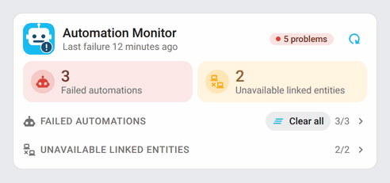 | 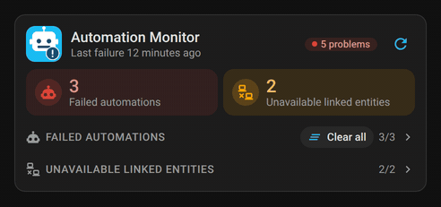 |

A click on a section title folds or unfolds its list, turning the chevron.

| Light | Dark |
|---|---|
| 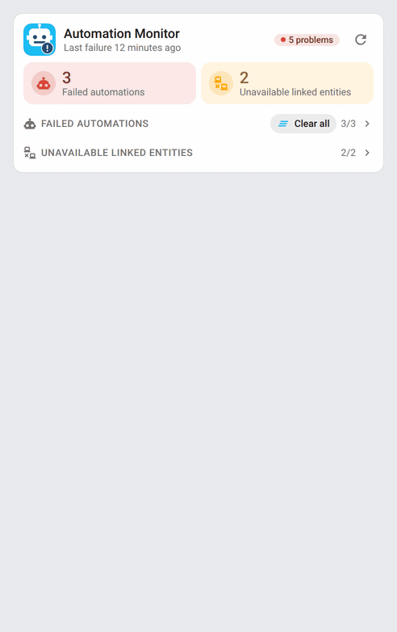 | 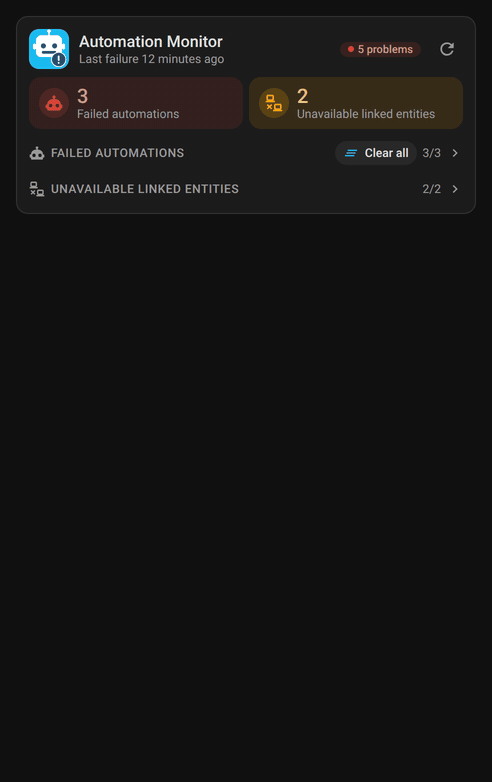 |

| Light (lists folded by default) | Dark (lists folded by default) |
|---|---|
| 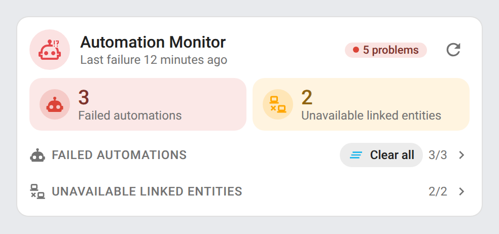 | 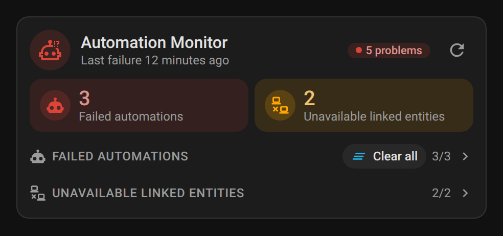 |
|  | 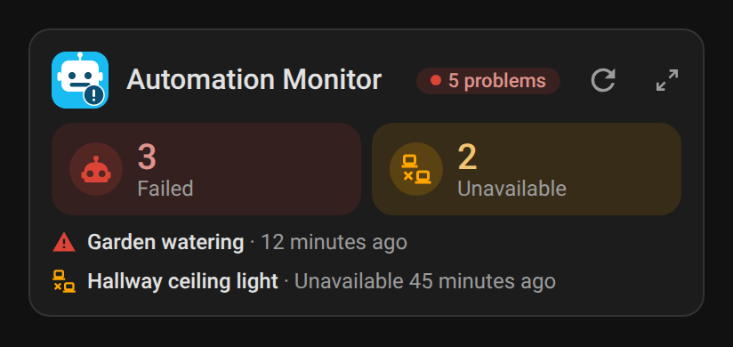 |
| 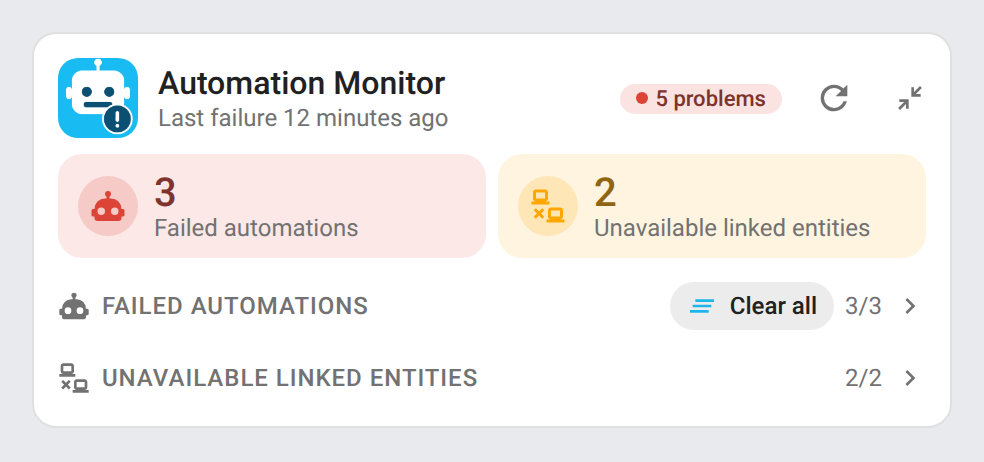 | 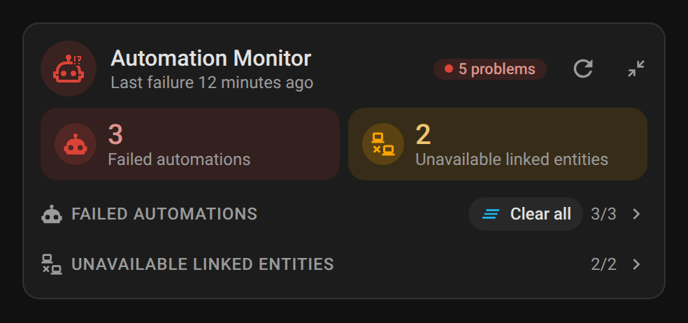 |

Lists unfolded:

| Light | Dark |
|---|---|
|  | 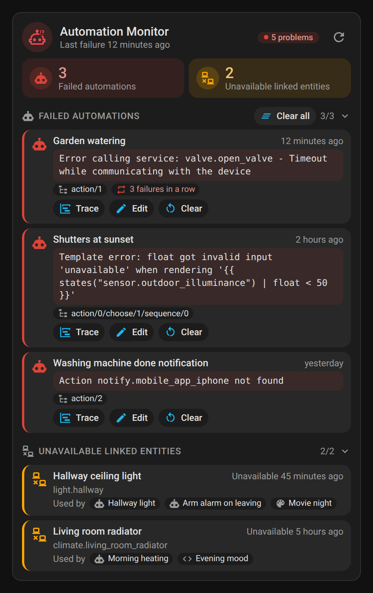 |

When everything works (Automation Monitor Card, then Automation Monitor Mini Card):

| Light | Dark |
|---|---|
| 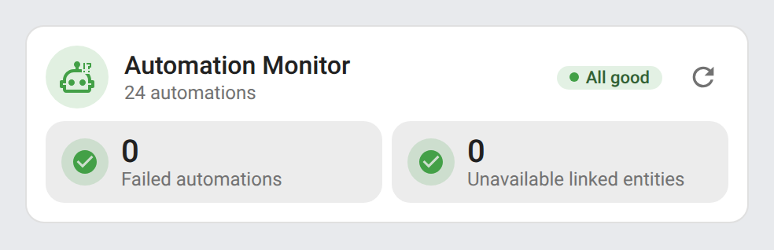 | 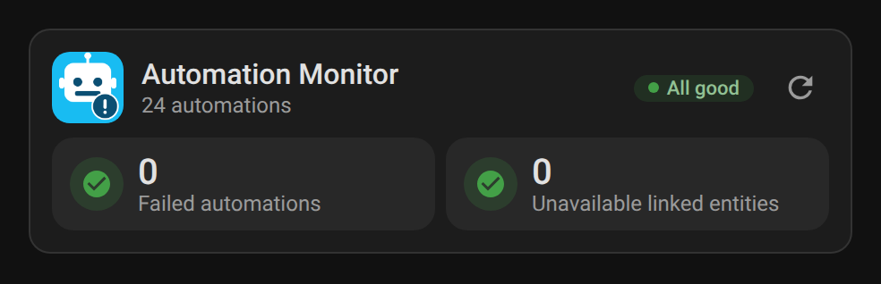 |
| 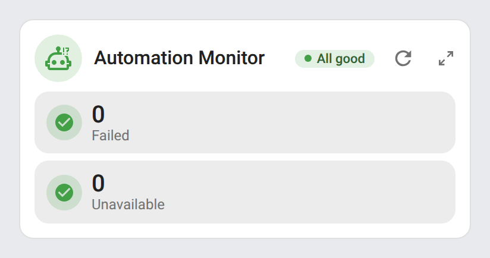 | 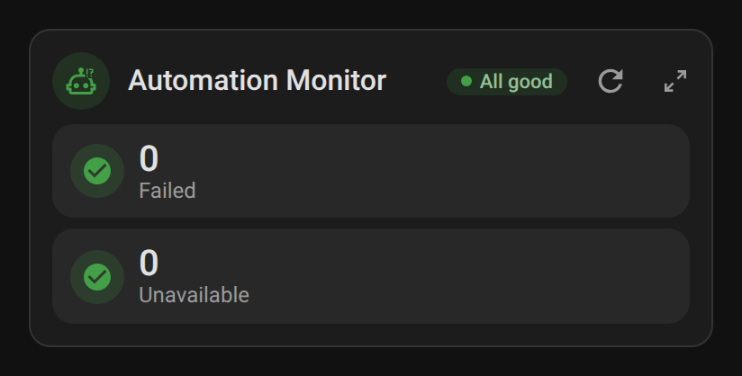 |

## How it works

The integration exposes two sensors: **Failed automations**, whose `automations` attribute lists the automations whose last run failed (error message, failed step, time, consecutive failures), and **Linked entities unavailable**, whose `entities` attribute lists the entities used by automations, scripts and scenes that have been unavailable longer than the configured threshold. The cards find both sensors in the entity registry by their `translation_key` (`failed_automations`, `linked_entities_unavailable`), so they work even when the entity ids are translated or renamed.

The **Trace** and **Edit** buttons use the automation's id: they work for automations created in the UI (or with an `id:` in YAML). Scripts and scenes listed under **Used by** open their editor the same way.

**Clear** calls `automation_monitor.reset` for one automation, **Clear all** for all of them: the failure disappears until the automation fails again. When `exclude_devices` or `exclude_entities` hide some failed automations, **Clear all** only clears the ones listed (one call per automation) and leaves the hidden ones untouched. **Refresh** calls `automation_monitor.rebuild_linked_entities`, useful right after editing a script or a scene.

What counts as a failure, the unavailability threshold, the exclusions and the Repairs issues are set in the integration's options: see its [documentation](https://github.com/olli-dot-dev/ha-automation-monitor#configuration).

## Development

```bash
npm install
npm run build        # bundles src/automation-monitor-card.js + images/ into dist/automation-monitor-card.js
npm run check        # builds and checks the card (run in CI)
npm run screenshots  # renders the cards (and the GIFs, needs ffmpeg) with mock data into screenshots/
```

`dist/` is not committed: `npm run build` creates it locally, CI builds it on every push, and the release workflow attaches the built file to the release, which is where the Marketplace installs it from.

### Releasing

1. Bump `version` in `package.json`
2. Add a `## <version>` section at the top of [CHANGELOG.md](https://github.com/juju35/ha-automation-monitor-card/blob/main/CHANGELOG.md)
3. Push to `main`: the **Release** workflow builds the card, creates the tag and the GitHub release with the changelog section as notes, and attaches `automation-monitor-card.js`

## Translations

The cards auto-detect the language from your Home Assistant settings (Brazilian Portuguese `pt-BR` uses the European Portuguese texts). Currently supported:

| Language | Code |
|---|---|
| English | `en` |
| Français | `fr` |
| Deutsch | `de` |
| Español | `es` |
| Српски | `sr` |
| Srpski (latinica) | `sr-Latn` |
| Italiano | `it` |
| Nederlands | `nl` |
| Português (Portugal) | `pt` |
| Polski | `pl` |
| Română | `ro` |
| Dansk | `da` |
| Svenska | `sv` |
| Български | `bg` |
| Русский | `ru` |
| Українська | `uk` |
| Magyar | `hu` |
| Slovenčina | `sk` |
| Čeština | `cs` |
| Slovenščina | `sl` |
| Latviešu | `lv` |
| Ελληνικά | `el` |

Contributions for additional languages are welcome!

## Credits

The Automation Monitor integration and its logo are by [olli-dot-dev](https://github.com/olli-dot-dev/ha-automation-monitor) (MIT License). This project is an independent card for it.

## License

[MIT](https://github.com/juju35/ha-automation-monitor-card/blob/main/LICENSE)

## Support

If you find this project useful, you can support its development:

<a href="https://buymeacoffee.com/julienstep9"></a>
